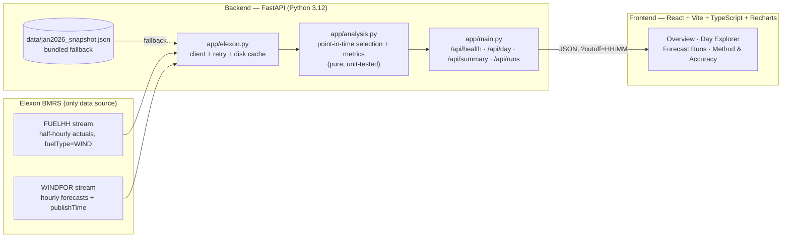

# Day-Ahead Wind Forecast — Decision & Accuracy Dashboard

**For a UK energy utility's day-ahead buying team.** Every day, the desk must commit to
electricity purchases a day before delivery. How much extra power to buy beyond wind depends
on a wind forecast — so two questions decide real money:

1. **What was the latest wind forecast actually available when the decision had to be made?**
2. **How accurate was that forecast, honestly measured?**

This app answers both using **only Elexon BMRS data** (FUELHH actuals + WINDFOR forecasts),
with a strict point-in-time rule: a forecast only counts if it was published *before* the
decision deadline. Nothing published later is allowed to flatter the numbers.

> **Scope interpretation (documented as required):** "purchase decisions in January 2026"
> is interpreted as **delivery days 1–31 January 2026**, each decided on **D-1** — the day
> before delivery. The default decision deadline is **09:50 UK time on D-1**, the Nord Pool
> N2EX GB day-ahead auction gate closure. January in the UK is GMT, so UK time = UTC and no
> DST adjustment applies. At that gate, the latest available WINDFOR run is the **09:30 D-1**
> publication (lead times 14.5 h for the 00:00 delivery hour to 37.5 h for 23:00).

**Deployment:** see `DEPLOYMENT.md` (Vercel serverless or Docker).

---

## Key findings — January 2026 (decision deadline 09:50 on D-1)

Measured over all **744 delivery hours**, grading only the forecast available at decision time:

| Metric | Value | What it means |
|---|---|---|
| MAE | **2,123 MW** | Average hourly miss of the forecast the desk had to trade on |
| RMSE | **2,617 MW** | Large misses are common enough to pull RMSE well above MAE |
| Bias | **+1,840 MW** | Systematic **over-forecast**: planned wind that did not arrive |
| Mean actual wind | 11,581 MW | January 2026 average GB wind generation (hourly) |
| Normalised MAE | 18.3% | MAE as a share of mean actual |
| Correlation | 0.93 | The forecast tracked the day's *shape* well — the problem is level, not timing |
| Over-forecast hours | 628 of 744 (84%) | Shortfall-vs-plan was the norm, not bad luck |
| Net energy error | ≈ +1,369 GWh | Signed cumulative over-forecast across the month |

**Worst days:** 28 Jan (MAE ≈ 5,375 MW), 12 Jan (≈ 4,901 MW), 11 Jan (≈ 4,897 MW).

**The look-ahead trap:** if you (incorrectly) grade the *latest forecast ever published* for
each hour — including runs issued after the deadline, even during the delivery day — MAE
"improves" to ≈ **1,767 MW**. That number is unobtainable in real trading: those forecasts
did not exist at decision time. The app shows both figures side by side, clearly labelled,
so the desk sees its true decision-time accuracy and the size of the leakage illusion.

**Caveat to investigate (not a proven claim):** WINDFOR may cover a wider wind scope than the
transmission-metered wind reported in FUELHH. If so, part of the positive bias could be a
coverage difference rather than pure forecast error. Reconciling the two scopes is a
recommended follow-up; this app reports the data as published.

---

## Architecture



**Design centre — the point-in-time rule.** For each delivery hour, the *decision forecast*
is the forecast with the greatest `publishTime` **strictly before** the deadline for that
delivery day (`app/analysis.py: select_decision_forecasts`). The *latest-ever* forecast is
computed separately and only ever displayed as a labelled leakage comparison.

**Resolution alignment.** WINDFOR is hourly; FUELHH is half-hourly. Each hourly actual is the
mean of the two half-hours starting at :00 and :30 (every January hour has exactly two
records; 744 hours total).

---

## Files and directories

```
reint-wind-forecast/
├── README.md                  ← this file
├── DEPLOYMENT.md              ← Vercel / container deployment guide
├── docker-compose.yml         ← backend :8000 + frontend :8080
├── vercel.json                ← Vercel static frontend + Python serverless API
├── requirements.txt           ← root deps for the Vercel Python function
├── api/
│   └── index.py               ← Vercel entry point: re-exports the FastAPI app
├── backend/
│   ├── Dockerfile             ← python:3.12-slim, uvicorn on 8000
│   ├── requirements.txt       ← fastapi, uvicorn, httpx, pytest
│   ├── app/
│   │   ├── main.py            ← FastAPI endpoints + cutoff validation + CORS
│   │   ├── elexon.py          ← Elexon client (retry, disk cache, snapshot fallback)
│   │   └── analysis.py        ← pure functions: hourly actuals, point-in-time
│   │                            selection, metrics, daily & lead-time breakdowns
│   ├── scripts/
│   │   └── fetch_snapshot.py  ← rebuilds the bundled snapshot from the live API
│   ├── data/
│   │   └── jan2026_snapshot.json  ← Jan 2026 FUELHH WIND rows + WINDFOR rows (bundled)
│   └── tests/
│       └── test_analysis.py   ← offline pytest suite (synthetic fixtures)
└── frontend/
    ├── Dockerfile             ← node build → nginx serving dist on :80
    ├── nginx.conf
    ├── package.json
    └── src/
        ├── main.tsx
        ├── api.ts             ← typed API client (VITE_API_BASE)
        ├── App.tsx            ← all four views
        └── index.css          ← dark navy / teal / amber dashboard theme
```

---

## How to run

### Option A — Docker Compose (recommended)

```bash
docker compose up --build
# Frontend: http://localhost:8080
# Backend:  http://localhost:8000  (docs at /docs)
```

### Option B — Local development

Backend:

```bash
cd backend
python3 -m venv .venv && source .venv/bin/activate
pip install -r requirements.txt
uvicorn app.main:app --port 8000
```

Frontend (in a second terminal):

```bash
cd frontend
npm install
npm run dev        # http://localhost:5173
# Production build check: npm run build
```

The backend serves the bundled January 2026 snapshot out of the box (no network needed);
if live Elexon data is fetched it is cached under `backend/data/cache/`, and any live-fetch
failure falls back to the snapshot automatically.

### Tests

```bash
cd backend && python -m pytest tests/ -q   # offline, synthetic fixtures
```

The suite pins the behaviours that matter: point-in-time selection never picks a
post-deadline (or exactly-at-deadline) forecast, hourly averaging of half-hourly actuals,
metric formulas on hand-computable numbers, deadline arithmetic, and lead-time calculation.

### Regenerating the snapshot

```bash
cd backend && python scripts/fetch_snapshot.py
```

Fetches FUELHH wind actuals for 1–31 Jan 2026 and WINDFOR forecasts published
2025-12-30 → 2026-02-01 targeting January delivery hours, and rewrites
`backend/data/jan2026_snapshot.json`.

---

## API reference

All endpoints accept `?cutoff=HH:MM` (default `09:50`, validated; the UI offers 09:50
Nord Pool day-ahead, 11:00 EPEX day-ahead, and 17:30 intraday IDA1 as a sensitivity).

| Endpoint | Returns |
|---|---|
| `GET /api/health` | `{ "status": "ok" }` |
| `GET /api/day/{YYYY-MM-DD}?cutoff=HH:MM` | Hourly series for the delivery day: hour, actual, decision forecast, its `publishTime`, lead hours, error MW, error %; day summary metrics; per-hour latest-ever (leaky) comparison |
| `GET /api/summary?cutoff=HH:MM` | January overview: overall metrics (decision + leaky), daily table (MAE, RMSE, bias, mean actual), lead-time bucket table, worst/best days |
| `GET /api/runs/{YYYY-MM-DD}?cutoff=HH:MM` | All publish runs targeting that delivery day, each flagged eligible (`publishTime` < deadline) and which one is selected |

Example:

```bash
curl "http://localhost:8000/api/summary?cutoff=09:50"
curl "http://localhost:8000/api/day/2026-01-15?cutoff=09:50"
curl "http://localhost:8000/api/runs/2026-01-15?cutoff=09:50"
```

---

## Methodology

- **Actuals:** FUELHH stream, `fuelType == "WIND"`, settlement dates 2026-01-01 → 2026-01-31
  (1,488 half-hourly rows), averaged to 744 hourly values.
- **Forecasts:** WINDFOR stream; publish cadence ≈ 8×/day (02:30, 04:30, 07:30, 09:30,
  11:30, 15:30, 18:30, 22:30 UTC); hourly values with `publishTime`.
- **Decision forecast:** per delivery hour, max `publishTime` strictly before the deadline.
  At the 09:50 default this is always the 09:30 D-1 run. (Note: an 11:00 cutoff selects the
  same run, because the next run is 11:30 — the UI's 11:00 sensitivity therefore matches
  09:50; the 17:30 intraday sensitivity selects the 15:30 D-1 run and scores better, as
  expected with ~6 h less lead time.)
- **Metrics:** error = forecast − actual; MAE, RMSE, bias, nMAE (MAE / mean actual), MAPE,
  Pearson correlation, over/under-forecast hour counts, cumulative energy error in GWh
  (Σ hourly error × 1 h / 1000). Full definitions are also in the app's *Method & Accuracy*
  view.
- **Lead-time buckets:** accuracy grouped by hours between publication and delivery
  (12–18 h, 18–24 h, 24–30 h, 30–38 h are populated at the default gate).

## Deployment

See **`DEPLOYMENT.md`** — frontend on Vercel, backend either as a Vercel serverless function
from this same repo (`api/index.py` + `vercel.json`) or on any container host via the
Dockerfiles / docker-compose. The bundled snapshot makes the serverless deployment work
without live Elexon access.

## AI tools disclosure

**Built with assistance from an AI coding assistant (Muse) — explicitly, as the brief
requests.** The AI assisted with implementation, testing, and documentation; all API facts,
the point-in-time methodology, and the reported January 2026 figures were verified against
the live Elexon BMRS API and reproduced by the code in this repo.

## Data source

Elexon BMRS — https://bmrs.elexon.co.uk/ ·
[FUELHH](https://data.elexon.co.uk/bmrs/api/v1/datasets/FUELHH/stream) ·
[WINDFOR](https://data.elexon.co.uk/bmrs/api/v1/datasets/WINDFOR/stream)
